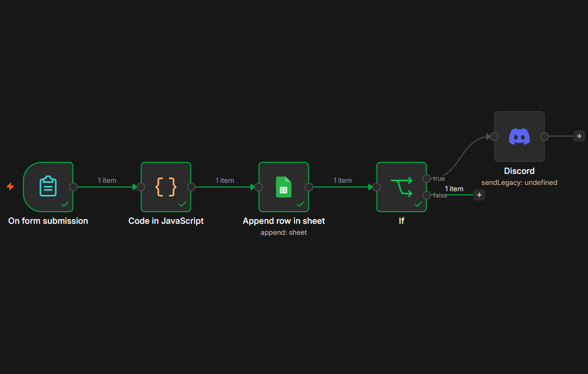
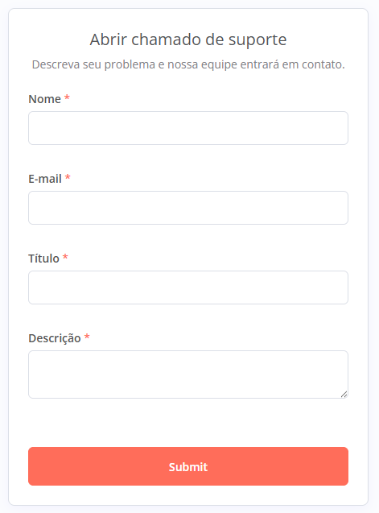
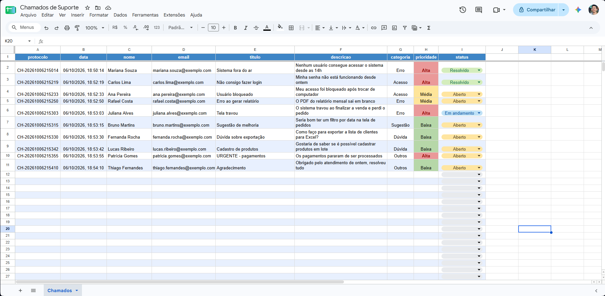
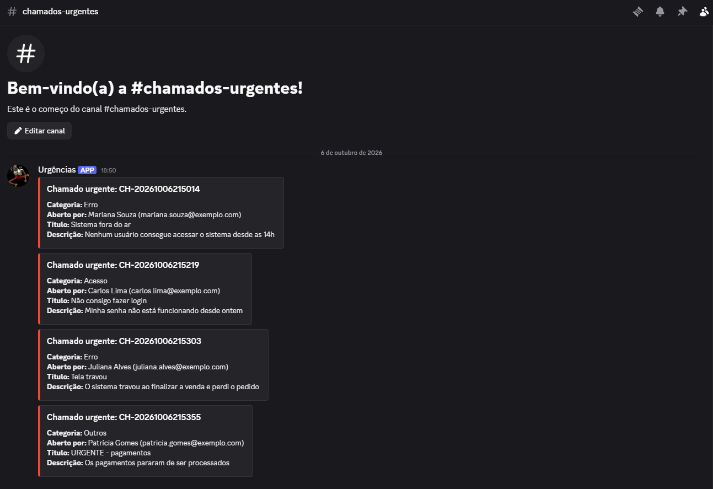

# Triagem Automática de Chamados de Suporte

Automação construída com **n8n** que recebe chamados de suporte por um formulário, classifica cada um por **categoria** e **prioridade**, registra tudo em uma planilha do **Google Sheets** e envia um alerta no **Discord** quando o chamado é urgente.



## Motivação

Trabalhei quase 2 anos com suporte de software e via na prática o tempo gasto para ler, classificar e priorizar cada chamado manualmente. Este projeto automatiza essa primeira triagem, para que os chamados urgentes cheguem mais rápido a quem pode resolvê-los.

## Como funciona

```
Formulário → Classificação (JavaScript) → Google Sheets → Prioridade alta? → Alerta no Discord
```

1. **Formulário:** o usuário informa nome, e-mail, título e descrição do problema.
2. **Classificação:** um nó de código em JavaScript ([`classificacao.js`](classificacao.js)) normaliza o texto (minúsculas e sem acentos) e procura palavras-chave para definir:
   - **Categoria:** Acesso, Erro, Sugestão, Dúvida ou Outros
   - **Prioridade:** Alta (palavras urgentes como "travou", "fora do ar", "não consigo"), Média (erros e problemas de acesso) ou Baixa
   - **Protocolo:** identificador do chamado gerado a partir da data e hora
3. **Registro:** todo chamado é salvo em uma planilha com data, categoria, prioridade e status.
4. **Alerta:** chamados de prioridade **Alta** disparam uma mensagem no Discord via webhook.

## Demonstração

**Formulário de abertura**



**Planilha de chamados**, com cores por prioridade e status editável pela equipe



**Alertas de chamados urgentes no Discord**



## Tecnologias

- n8n (automação de fluxos)
- JavaScript
- Google Sheets API (OAuth2)
- Discord Webhooks

## Como executar

1. Instale o [Node.js](https://nodejs.org) (versão LTS) e rode o n8n localmente:
   ```
   npx n8n
   ```
   O editor fica disponível em `http://localhost:5678`.
2. No n8n, importe o arquivo [`triagem-chamados.json`](triagem-chamados.json) (menu **⋯ → Import from file**).
3. Crie uma planilha no Google Sheets com os cabeçalhos:
   `protocolo | data | nome | email | titulo | descricao | categoria | prioridade | status`
4. Configure as credenciais no n8n:
   - **Google Sheets OAuth2:** crie um projeto no Google Cloud, ative as APIs do Google Sheets e do Google Drive e gere um Client ID e Client Secret.
   - **Discord Webhook:** crie um webhook em um canal do seu servidor e cole a URL na credencial.
5. No nó **Append row in sheet**, selecione a sua planilha.
6. Clique em **Execute workflow** e envie um chamado pelo formulário.

As credenciais ficam salvas apenas no n8n e não fazem parte do arquivo exportado.

## Exemplos de classificação

| Título | Descrição | Categoria | Prioridade |
|---|---|---|---|
| Sistema fora do ar | Nenhum usuário consegue acessar o sistema desde as 14h | Erro | Alta |
| Não consigo fazer login | Minha senha não está funcionando desde ontem | Acesso | Alta |
| Usuário bloqueado | Meu acesso foi bloqueado após trocar de computador | Acesso | Média |
| Erro ao gerar relatório | O PDF do relatório mensal sai em branco | Erro | Média |
| Sugestão de melhoria | Seria bom ter um filtro por data na tela de pedidos | Sugestão | Baixa |
| Dúvida sobre exportação | Como faço para exportar a lista de clientes para Excel? | Dúvida | Baixa |

## Próximos passos

- **Palavras-chave mais flexíveis:** hoje a busca é por trecho exato, então "pararam" não é reconhecido como "parou". Comparar pelo radical das palavras ou usar um modelo de IA para classificar deixaria a triagem mais precisa.
- **Protocolo único:** gerar um ID sequencial, evitando protocolos repetidos em chamados enviados no mesmo segundo, e usar o horário de Brasília no protocolo.
- **Confirmação por e-mail:** enviar ao usuário uma mensagem com o número do protocolo.
- **Painel de indicadores:** gráficos com volume de chamados por categoria e tempo de resolução.
